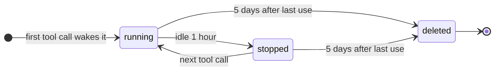

# Operations

This page is for operators keeping a Strands Factory deployment healthy. It covers the sandbox's lifecycle and limits, where to look when something goes wrong, and fixes for the failures you are most likely to see. It assumes a deployment built with [Deploy your own](deploy.md).

## The sandbox

Every file and shell operation the agent performs runs in the sandbox runtime: a second AgentCore Runtime on EC2-backed Runtime instances, separate from the agent. Each agent session gets its own sandbox session with a persistent workspace volume. A sessionless invoke, such as a one-shot CLI call, gets a fresh throwaway sandbox so it shares no files with anything.

We put the sandbox on instances instead of the microVM because a maintainer's work (cloning large repositories, building, running full test suites) needs a disk that survives across turns and days. The cost is that a stopped sandbox keeps billing for its volume, so the deployment deletes idle ones itself.

- **Wake.** The first file or shell call in a session starts the sandbox and pushes the packaged skills into the workspace. Agent builds never touch the sandbox, so a run that needs no tools never wakes one.
- **Stop.** An instance idle for one hour stops. Its workspace volume stays; the next call re-attaches it. Background processes do not survive a stop, and the agent is told so on its next tool result.
- **Delete.** AgentCore keeps stopped sessions indefinitely, so the harness owns the TTL. Every use moves a one-time EventBridge Scheduler schedule to five days out; when it fires, it deletes the session's instance, network interface, and volume. A sandbox in active use is never deleted. Throwaway sandboxes get one fixed deletion past the agent's maximum run lifetime.
- **Full disk.** At wake, and after repeated write failures, the sandbox prunes regenerable caches (package manager stores, build directories) once the workspace passes 85% full. The agent is told what was deleted.

### Tools in the image

The sandbox runs as a non-root user with no `sudo`, so the image carries the tools a session would otherwise fetch by hand. [`sandbox/Dockerfile.sandbox`](../sandbox/Dockerfile.sandbox) pins every version.

| Area | Preinstalled |
|---|---|
| Source control | `git`, `openssh-client`, `gh` |
| Search and shell | `rg`, `fd`, `jq`, `curl`, `patch`, `rsync`, `sqlite3`, `zip`, `unzip`, `tar` with gzip, xz, and bzip2 |
| Python | Python 3.13, `uv` and `uvx`. `uv python install 3.12` adds another version in seconds |
| Node.js | Node.js 22 with `npm`; `pnpm` and `yarn` through corepack, which fetches the version a repository pins on first use |
| Rust | `rustup`, with `cargo` and `rustc` on the path. `rustup toolchain install` downloads the pinned minimal toolchain, or the one a repository's `rust-toolchain.toml` names |
| Native builds | `gcc`, `g++`, `make`, `pkg-config`, and the OpenSSL and PortAudio headers |
| Browsers | Headless Chromium for Playwright, at `$PLAYWRIGHT_CHROMIUM_EXECUTABLE` |
| Other | AWS CLI v1, Ollama and llama.cpp for local model tests |

`gh` has no credential. The agent's GitHub token never reaches the sandbox, so GitHub API calls and writes go through `use_github`. The Rust toolchain is not baked in because it would add about 175 MB to every sandbox's image pull. It installs to the root volume, so it is gone after the instance stops. The sandbox image size check (`sandbox/check_image_size.py`) caps the image at 500 MB compressed.

### Limits

| Limit | Value |
|---|---|
| Instance types | `m7g.xlarge`, `m8g.xlarge`, `c7g.2xlarge` (arm64) |
| Workspace volume | 40 GiB gp3, encrypted, mounted at `/mnt/workspace` |
| Root volume free space | 30 GiB |
| Command body | 64 KB |
| Command timeout | 1 to 3,600 seconds |
| Idle stop | 1 hour |
| Session maximum lifetime | 14 days |
| Deletion after last use | 5 days |

Values live in `harness/src/strandly/core/constants.py` and `infra/stacks/sandbox_stack.py`. Changing the instance types or volume size creates a new capacity provider and a new sandbox runtime, because AgentCore's compute settings are create-only.

### Credentials and network

The sandbox role has no secret, session-store, ledger, memory, or people-directory permissions. Git operations use `STRANDLY_SANDBOX_GIT_TOKEN`, which should be narrower than the agent's GitHub token. With `sandbox_bedrock_grants` on (the default), sandbox code can call Bedrock so the agent can run end-to-end tests of agents it builds; turn it off if you do not need that.

The sandbox sits in private subnets behind one NAT gateway with an egress-only security group. Egress is open on purpose. To restrict it, add a proxy or firewall on the NAT route.

### Direct model providers

Sandbox code can call Anthropic, OpenAI, and Google Vertex AI without stored API keys, for tests of a provider's own SDK or adapter. It is off by default. The sandbox role exchanges a short-lived AWS STS web identity token (`sts:GetWebIdentityToken`, at most 300 seconds) for a provider credential; the agent's role never gets the permission.

1. Enable outbound web identity federation in the AWS account, then map the sandbox role's exact ARN (the Sandbox stack's `SandboxExecRoleArn` output, `<name>-<env>-sandbox-runtime-exec`) to a dedicated, least-privilege service account in each provider console or Google workload identity pool. These are manual account changes.
2. Set the context key `sandbox_provider_federation` (or the `STRANDLY_SANDBOX_PROVIDER_FEDERATION` environment variable at synth time) to JSON with only public ids: `anthropic` (`federation_rule_id`, `organization_id`, `service_account_id`, `workspace_id`), `openai` (`identity_provider_id`, `service_account_id`), and `google` (`project_id`, `project_number`, `pool_id`, `provider_id`, `location`). Omit a provider to disable it; a partial or unknown entry fails synthesis. Redeploy the Sandbox stack.
3. In the sandbox, use the helper on `PYTHONPATH` (`/opt/strandly/strandly_sandbox_auth.py`; a `.mjs` twin for TypeScript) to build refresh-aware clients, and check each provider with `python -m strandly_sandbox_auth check <anthropic|openai|google>` or `smoke <provider> --model <id>`, which makes a paid request. Install `boto3>=1.43.101`, `anthropic>=0.118.0,<3.0.0`, `openai>=2.45.0`, `google-genai>=1.68.0`, and `google-auth[requests]>=2.29.0` in the environment that runs the code.

Any code in the sandbox can mint these credentials, so this is not per-task authorization. Use separate provider workspaces with model restrictions and spending limits.

## Observability

Start with the run ledger: every run writes a row when it starts and ends, and the portal's session list is that table. For deeper detail, go to the logs.

| Signal | Where |
|---|---|
| Agent and sandbox logs | CloudWatch, `/aws/bedrock-agentcore/runtimes/<runtime-id>-DEFAULT`, kept 30 days |
| Traces | AWS X-Ray, stored in the `aws/spans` log group and browsable in CloudWatch GenAI Observability once CloudWatch Transaction Search is enabled for the account (the stacks do not enable it). See [Traces](#traces) |
| Ingress, scheduler, and API logs | The Lambda functions' CloudWatch log groups |
| Metrics and alarms | The Monitoring stack (`monitoring_enabled`) and its `<name>-<env>-ops` CloudWatch dashboard |
| Cost | The Cost stack: AWS Cost Anomaly Detection on the deployment's cost-allocation tags |
| GitHub writes | The Audit stack: an independent job that asks GitHub what the bot account did |

### Traces

Two sources write spans to X-Ray:

- The agent runs under `opentelemetry-instrument` (AWS Distro for OpenTelemetry) and exports its own spans (invocations, model calls, tools) with `service.name` `strands-factory`.
- The AgentRuntime stack adds a CloudWatch Logs delivery per agent runtime (`<runtime name>-traces`) that sends the runtime's AgentCore `TRACES` to the `<name>_<env>_agent-traces-xray` X-Ray destination. X-Ray accepts them through the account's resource policy for `delivery.logs.amazonaws.com`, which AWS creates on the first delivery when the deploying principal may call `xray:PutResourcePolicy`.

The agent samples with `OTEL_TRACES_SAMPLER`, set from the `traces_sampler` stack switch ([Stack switches](deploy.md#stack-switches)), `always_on` by default. The ingresses invoke the runtime from Lambda functions whose unsampled X-Ray trace header reaches the runtime, so a parent-based sampler (the OpenTelemetry default) records nothing for them. Every span that `always_on` records is ingested into `aws/spans` and billed as CloudWatch Logs ingestion; Transaction Search indexes a sample of it, 1% by default. To record fewer, set `traces_sampler=traceidratio` and `traces_sampler_arg` to the fraction to keep.

To verify a deployment, check that `aws logs describe-deliveries` lists a delivery from `<name>_<env>_agent-traces`, that the runtime's log lines for a new run carry `trace_sampled=True`, and that a CloudWatch Logs Insights query on `aws/spans` with `filter attributes.service.name = "strands-factory"` returns that run's spans.

Logs carry correlation ids across process boundaries and never include tokens. Runtime logs do contain prompts, tool output, and command text, which is why retention is bounded.

The Monitoring stack creates these alarms, named `<name>-<env>-<alarm>`:

| Alarm | Fires when |
|---|---|
| `failure-rate` | Too many runs end in failure |
| `invocation-spike` | Invocations jump well above normal |
| `dispatch-failed` | An ingress failed to invoke the runtime |
| `poll-silent` | The mention poller stopped reporting |
| `stuck-runs` | Runs have been in progress past the threshold (30 minutes by default) |
| `ledger-write-failed`, `ledger-throttle` | The run ledger is rejecting or throttling writes |
| `tool-errors` | Tool calls fail at a high rate |
| `work-product-parse-rate` | Runs produce work products the API cannot parse |
| `sandbox-system-errors`, `sandbox-wake-latency` | The sandbox fails at the platform level or is slow to wake |
| `sandbox-init-timeouts`, `sandbox-bad-gateway`, `sandbox-wake-failures`, `sandbox-enospc` | The agent logs sandbox start, transport, or disk-full failures |
| `session-storage-failure`, `session-write-failed`, `session-read-failed`, `transcript-write-failed` | The session store or transcript cannot be read or written |
| `sandbox-ttl-upsert-failures`, `sandbox-ttl-misconfigured`, `sandbox-ttl-target-errors`, `sandbox-ttl-dropped` | Sandbox deletion schedules are not being written or are failing to fire |

Set `alarm_email` to receive them by email; [Security model](security.md) lists the budgets and CloudTrail alerts you own on top of them. A stuck-run reaper also closes ledger rows whose runs are long gone, so one crashed run does not hold the alarm forever.

## Troubleshooting

**The portal or CLI answers `{"status": "starting", "retryable": true}` (HTTP 504).** The session is cold-starting. Repeat the same call; the portal and CLI already do.

**A command dies with a timeout although it was still working.** The command hit its own `timeout` (at most 3,600 seconds). Ask the agent to run long jobs in the background and poll them, or split the work.

**The agent says its background processes stopped.** The instance was stopped after an idle hour and restarted. Files are intact; processes are not. Restart them.

**The agent reports the workspace is full.** The prune already removed caches. Ask the agent to delete clones or artifacts it no longer needs, or start a new session for unrelated work.

**`SandboxTtlUpsertFailed` is non-zero.** A sandbox's deletion schedule could not be written. The run continues, but that sandbox may outlive its TTL and keep billing. Check the scheduler role in the Sandbox stack, then delete stale sessions with `DeleteCapacityProviderSession`.

**`poll-silent` fires.** The mention poller is not running or cannot reach GitHub. Check its Lambda's logs and that `STRANDLY_GITHUB_TOKEN` in the config secret is valid.

**A Slack DM gets no reaction.** Check that the Slack app's event URL points at the Slack stack, the signing secret matches, and the sender is in `allowed_users` or the people directory. Denials are logged by the Slack ingress Lambda.

**A scheduled job did not run.** Open it in the portal. A job from a GitHub mention stays paused until confirmed; `once` jobs move to `completed` and recurring jobs to `expired`. A paused or deleted job never fires, even if its EventBridge schedule still exists; an hourly reconcile tick repairs drift between the two.
