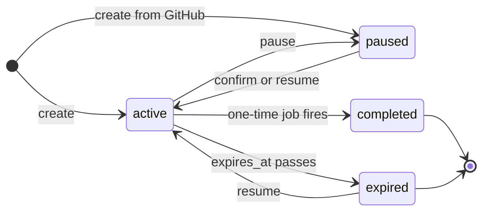

# Using Strands Factory

This page is for people who work with a deployed Strands Factory agent. It covers each surface you can reach it from, how sessions work, how to schedule work, and what each surface lets you do. To install the CLI and sign in, start with [Quickstart](quickstart.md).

## What can I ask it to do?

You ask in plain language. The agent picks a packaged skill when one fits the request, and you can name one to be explicit ("use the code-review skill on this PR").

| Skill | Use it to |
|---|---|
| `code-review` | Review a pull request with parallel specialist passes and post one deduplicated review |
| `first-response`, `triage` | Reproduce a new issue, find duplicates, and route it |
| `bug-verify` | Reproduce a bug report and post one evidence-backed comment |
| `implement` | Turn an issue into a pull request with tests and an independent review |
| `port` | Port a change between the Python and TypeScript SDKs |
| `dependabot-review` | Check whether a dependency bump breaks the repository |
| `integration-review` | Review an integrations catalog submission |
| `release-notes` | Draft release notes with a validated example per feature |
| `brief` | Summarize recent activity across your repositories |
| `diagrams`, `e2e-test`, `test-simplify`, `github` | Draw diagrams, run end-to-end tests, simplify a test suite, and use GitHub |

Skills live in `harness/src/strandly/skills/`. The set is curated in code; an operator can add skill packs through the profile ([Deploy your own](deploy.md#extend-it)).

### How code reviews test behavior

For suspected regressions, the adversarial reviewer runs the same experiment and inputs against
fixed base and head commits in separate source copies. It includes a legitimate success case and
records outputs, exit codes, repetitions, and execution limits. If a comparison cannot run, the
review leaves the regression claim unverified.

Behavioral reviews also cover the affected-package suites and relevant boundary, failure, and
operation-sequence cases. Focused experiments do not replace that coverage. Explicit review limits
still apply, and the review identifies blocked checks and untested integrations or platforms.

### How code reviews write findings

Each inline finding stands on its own. It names the caller and triggering input, the expected and
observed behavior, and the consequence, then suggests a fix for the cause. Confirmed defects are
stated directly; optional improvements stay suggestions.

A finding shows at most 15 lines. Reproduction details (revisions, setup, commands or inputs,
results, controls) sit in a collapsed block in the same comment, and a finding based only on
reading the source says that no reproduction ran. Limits that change a finding's impact or
confidence stay visible. The [code-review skill](../harness/src/strandly/skills/code-review/SKILL.md)
defines the full rules.

## Which surface should I use?

Use the portal or the CLI for anything interactive. Use Slack for quick questions from your phone. Use a GitHub `@mention` when the work belongs to an issue or pull request, because the result lands there.

| Surface | How you reach it | Who can use it |
|---|---|---|
| Portal | The deployment's portal URL in a browser | Anyone with a portal (Cognito) account |
| CLI `chat`, `sessions` | The client CLI, after `login` | Same as the portal |
| ACP | Your editor launches `<cli> acp` | Same as the portal |
| MCP | Your MCP client launches `<cli> mcp` | Same as the portal |
| MCP, direct | `<cli> mcp --agentcore` with AWS credentials | Callers with `InvokeAgentRuntime` on the runtime |
| Slack | A direct message to the bot, or a tag in the home channel when it is on | Slack users on the allow-list or in the people directory |
| GitHub | `@<handle>` in an issue, pull request, or comment | GitHub users on the allow-list, in the people directory, or in an allowed org |
| GitHub Actions | The Strands Factory action in a workflow | Default-branch workflows in repositories the deployment allows |

Ingresses check authorization before the agent sees a request, so the agent itself cannot widen who gets in. See [Architecture](architecture.md#trust-boundaries).

## Portal

The portal is the deployment's web app. You sign in with the account your operator created for you. Your first sign-in asks you to register an authenticator app (TOTP); every sign-in after that asks for its code.

- **Today, Pulls, Issues:** your repositories' open work, read from GitHub in the browser with your own GitHub token. That token never leaves the browser.
- **Strandly:** start a chat, watch a run's events stream in, rename sessions, cancel a run, and open the work products (reviews, comments, pull requests) a run produced.
- **Schedules:** create, edit, pause, resume, run, revert, and delete scheduled jobs.
- **Settings, Who are you?:** your GitHub login, which the portal sends with every request (see [Tell the agent who you are](#tell-the-agent-who-you-are)). **Use my GitHub login** fills it from your GitHub token in the browser.

A chat turn can run for many minutes. The portal launches it detached and polls for events, so closing the tab does not stop the run.

The model field under the chat input chooses the model and effort for your next turns. Leave it empty to run the deployment's model, or type any [harness model string](architecture.md#models); the suggestions are examples, not a list. Leave **Effort** empty for the model's default. When the harness cannot build your choice, the chat shows its reason and no turn starts. The browser remembers your choice. You can switch models between turns of one session: the next turn replays the conversation to the new model, which starts with a cold prompt cache. Each run records its model and effort, and the chat shows the newest run's model.

## CLI

The client CLI has the same commands for every deployment. Replace `strandly-example` with your deployment's command name.

| Command | What it does |
|---|---|
| `login`, `logout` | Browser sign-in, then `identity --verify`; sign out and revoke the refresh token |
| `whoami` | Show the deployment, token expiry, who you are, and the person the deployment maps you to |
| `identity [--verify \| --github LOGIN \| --clear]` | Show who you are; verify it with GitHub; set it by hand; forget it |
| `chat [-p TEXT] [-s SESSION]` | Interactive chat, or one turn with `-p` |
| `sessions [ID] [--json] [--tools]` | List recent sessions, or print one transcript |
| `acp` | ACP agent over stdio |
| `mcp [--agentcore]` | MCP server over stdio |

Run `login` again when its refresh token expires ([Sign-in](security.md#sign-in)). `login` listens on `http://localhost:8765/callback` for the browser redirect, so port 8765 must be free.

## Tell the agent who you are

The agent knows who you are from your sign-in: an operator binds your Cognito user to your row in the people directory ([Decide who can use it](deploy.md#decide-who-can-use-it)). Your client also sends a GitHub login in the header `X-Strandly-Person: github:<login>`, which never selects your person ([Portal and CLI users](security.md#portal-and-cli-users)).

- `identity --verify` (and `login`) reads a GitHub token from `gh auth token` or `GITHUB_TOKEN`, asks GitHub `GET /user` from your machine, and saves the login next to the login cache. The token goes only to GitHub; the client never stores it or sends it to the deployment.
- `identity --github LOGIN` sets the login by hand, unverified.

When your Cognito user is bound to an enabled person:

- The agent sees who you are for the whole conversation, introduced the same way as in Slack and GitHub runs.
- Schedules you create or change from a portal, CLI or ACP chat record you (`person:<person_id>`) and your login as the requester, and session titles record who set them.
- Memory works as in your Slack DMs: the run recalls your personal memory and the team's, and what it learns stays in your personal memory. With a Slack id in the directory, that is the memory your DMs use.

Without a binding, runs use team memory, and schedules you create from portal or CLI chat record your Cognito user.

## ACP and MCP

Both run as stdio subprocesses of your client and talk to the deployed agent over HTTPS with your login.

**MCP** exposes `ask` and `session`. `ask` takes a prompt and an optional session. Omit the session for a private scratch thread, pass a session id to continue one, or pass a GitHub issue or pull request URL to join the agent's thread for that item (the same thread its `@mentions` use).

**ACP** is remote task delegation, not a local coding agent. The agent works in its deployed workspace; your local files are not synced or mounted. There is no per-tool approval: a prompt can lead to remote actions within the deployment's policy. If your client requires per-tool approval or local read-only enforcement, do not use ACP mode.

## Slack

Send the bot a direct message. The agent reacts to acknowledge it, works, and replies in the thread.

- One session per thread. Reply in the thread to continue; start a new DM for a new session.
- Personal memory: facts the agent learns in your DMs are stored under your Slack identity, apart from team memory. Your portal, CLI and ACP runs share them ([Tell the agent who you are](#tell-the-agent-who-you-are)). Your DMs are not private: every portal user can read every session, Slack DMs included ([Portal and CLI users](security.md#portal-and-cli-users)).
- Buttons and other channels are not supported. Without a home channel, the agent posts to Slack only in runs that came from a DM.

### Home channel

An operator can give the team one home channel ([Configure integrations](deploy.md#configure-integrations)). It is off by default. Once it is on:

- The agent notifies maintainers there with one short title line and the details in that message's thread. It posts only what maintainers need to know or act on, keeps one thread per topic, and batches minor updates. These rules are prompt guidance; nothing in code caps or deduplicates posts.
- Scheduled jobs whose results go to the home channel, and monitoring alarms, use the same title and thread format.
- Tag the agent (`@` its name) to talk to it there, including inside a notification's thread. It ignores untagged messages, messages that start with `//`, and messages that open by addressing someone else. In a DM, every message still reaches it.
- When you tag the agent in a notification's thread, it starts with that notification's title, details, and the session it came from. The thread then works like a DM thread: one session, and it answers in the thread.
- Home-channel threads feed team memory, never personal memory. Runs from a DM cannot post to the home channel.

## GitHub

Mention the agent's handle in an issue, pull request, or comment:

```text
@strandly-example please review this PR, focusing on the retry logic
```

A poller checks GitHub notifications every five minutes by default, so expect a short delay before the agent reacts. It answers mentions only in repositories in the deployment's `managed_repositories` list; it marks any other mention read and skips it. Each issue or pull request has one session, whichever surface touches it, so a later mention continues where the last one left off.

The agent writes only to repositories in the deployment's `managed_repositories` list. Every GitHub mutation goes through a guarded tool that checks the target owner and attributes the write to the bot account, never to you.

## GitHub Actions

A workflow calls the agent with the [Strands Factory action](../action/action.yml). The action requests the job's GitHub OIDC token, so the caller stores no secret and needs only `permissions: id-token: write`. This workflow triages every new issue:

```yaml
name: Triage new issues
on:
  issues:
    types: [opened]
permissions:
  id-token: write
jobs:
  triage:
    runs-on: ubuntu-latest
    steps:
      - uses: strands-agents/devtools/strands-factory/action@main # pin a commit SHA
        with:
          url: https://abc123.execute-api.us-west-2.amazonaws.com
          prompt: |
            Use the triage skill on this issue. Label it and post one comment.
```

| Input | Default | Meaning |
|---|---|---|
| `url` | required | The deployment's API endpoint (the Dashboard stack's `ApiURL` output) |
| `prompt` | required | Free-form text: name the skills to use and add your instructions |
| `session` | the event's item | `issue:<n>`, `pr:<n>`, or `discussion:<n>` joins that item's session in the calling repository; another key (letters, digits, `-`, `_`) names a session of the repository; with no item, each run gets its own session |
| `wait` | `false` | Poll until the run ends and set the `result` output |
| `timeout` | `1800` | Seconds to wait for the launch and, with `wait`, the run |
| `audience` | `strandly` | The OIDC audience the deployment accepts |

The action outputs `status`, `session_id`, `task_id`, and, with `wait`, `result`. A failed or cancelled run fails the step. A poll reads only a task the agent runtime started on that session; any other task id gets HTTP 404, as does a task the runtime no longer holds because its instance was replaced.

The deployment admits a call only when all of these hold, checked from the token's verified claims:

- The repository matches the deployment's allow-list ([`actions_repositories`](deploy.md#stack-switches)).
- The run is on the deployment's default branch ([`actions_default_branch`](deploy.md#stack-switches)), and the workflow file comes from that branch of the same repository.
- The event is not `pull_request` or `pull_request_target`. A token cannot tell a fork's pull request apart, so pull request triggers are denied; use `issues`, `issue_comment`, `workflow_dispatch`, or `schedule`.
- The workflow is on the deployment's workflow allow-list ([`actions_workflows`](deploy.md#stack-switches)), when it has one.

The run is recorded with the trigger `github-actions:<owner>/<repo>/<workflow file>`, and the agent sees the repository, workflow, run, and actor. A run on an issue shares that issue's session with mentions. Keep untrusted text out of `prompt`: pass the issue number through `session` and let the agent read the issue, rather than pasting its body into the prompt.

## Schedule work

You schedule work by asking for it ("every weekday at 9:00 Istanbul time, triage new issues in strands-agents/sdk-python") or in the portal's Schedules page. A job has a prompt, an optional skill, a schedule, a timezone, and a session mode.

![How a schedule runs. A verified requester asks for a job in Slack, GitHub, or portal chat. The agent's schedule tool saves the job in the schedules table, the source of truth, and creates one EventBridge schedule for it. Jobs created from GitHub start paused until a new mention confirms them. When the schedule fires, the scheduled invoker re-reads the job, skips it if it is paused or deleted, and invokes a new agent run in the job's session (daily, single, or per-run), which posts its results to the job's Slack thread or GitHub issue when it has one.](assets/diagrams/schedules-lifecycle.svg)

*The table, not the timer, decides whether a job runs. The portal's Schedules page writes to the same table.*

| Session mode | Each run |
|---|---|
| `daily` (default) | Shares a session with other runs on the same day |
| `single` | Continues one long-lived session |
| `per-run` | Starts a fresh session |



The schedule is the source of truth at fire time: a paused or deleted job never runs, even if its timer still exists. Each job keeps a revision history, and the portal can revert to an earlier revision.

Every job belongs to the team. Any verified requester and any scheduled run can create, change, pause, resume, or delete any job; a run without a verified requester can only list jobs. `created_by`, `updated_by`, and the revision history record who made each change, for audit only.

On every surface, a recurring job repeats at most once an hour and expires at most 90 days after it is created, changed, or resumed, and the team holds at most 100 active jobs ([`schedules_max_active`](deploy.md#stack-switches)). An expiry set later than that, or removed, becomes 90 days from now. Resume an expired job to run it for another 90 days.

| | Through the agent (Slack, GitHub, portal chat, scheduled runs) | Portal Schedules page |
|---|---|---|
| Prompt length | 8,000 characters | 20,000 characters |
| Run now | At most every 15 minutes per job, never from a scheduled run | Any time |

A recurring job saved under an older, shorter minimum interval keeps running on its schedule. Anyone can pause or delete it; a change or resume that keeps the faster schedule is refused, so set one that runs at most hourly first.

A job created from a GitHub mention starts paused. A new mention from the same person confirms it, and until then only that person can change what it runs. Slack and portal requests skip that step because their identity is already verified. A GitHub Actions run can create or change jobs only when the operator opts its repository in ([`actions_schedule_repositories`](deploy.md#stack-switches)). A scheduled job never posts to a Slack DM. In Slack it posts only to the home channel when it is on: to the home-channel thread the request came from, or as a new notification. A job asked for from a DM reports to the home channel, and with the home channel off its result stays in the run's session, where the portal shows it. Its GitHub destination is the item where it was created or one in a repository of the deployment's allowed owners. The portal Schedules page and the schedules API can keep or clear a job's Slack destination but never set one; they can name a GitHub issue, PR or discussion. Each run checks its Slack destination again, and a run whose job stores any other Slack destination, such as a DM from an older job, posts nowhere.

The agent can schedule itself. A scheduled run acts as the team: it uses team memory, the agent's limits above, and its job's notify destination as its origin, so a follow-up job it creates reports to the same home-channel thread or GitHub item. A one-time job it creates must be at least 15 minutes away, it never runs a job now, and it never confirms a job waiting for a GitHub mention. Each run's prompt names its job, and the run can pause that job, for example when its goal is done. The revision history records each change a run made as coming from that job's run.

## Who can do what

| Action | Portal and CLI | Slack | GitHub | GitHub Actions | Scheduled run |
|---|---|---|---|---|---|
| Chat with the agent | Yes | Yes | Yes | Yes | Not applicable |
| See all sessions | Yes | No | No | No, only its own runs | No |
| Agent writes to GitHub | Managed repositories only | Managed repositories only | Managed repositories only | Managed repositories only | Managed repositories only |
| Agent posts to Slack | No | Reply in thread | No | No, unless home channel is on | Home channel only, when it is on; never a DM |
| Create schedules | Yes (ACP: with a bound person) | Yes | Yes, after confirmation | Opted-in repositories only | Yes |
| Edit any schedule | Yes | Yes | Yes, except another person's unconfirmed job | Opted-in repositories only | Yes, except an unconfirmed job |
| Change who is allowed | No (operator only) | No | No | No | No |

Nobody can change the allow-lists or the people directory through the agent. Only the operator edits them (see [Deploy your own](deploy.md#decide-who-can-use-it)).
